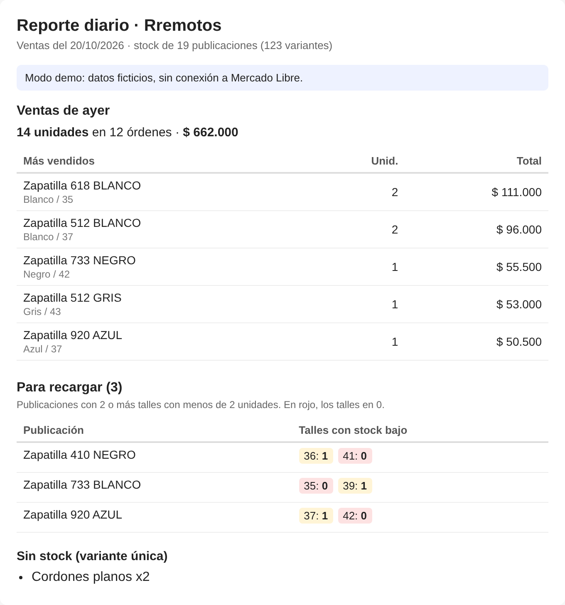
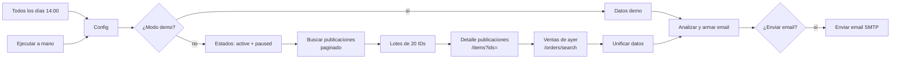

# Rremotos · Reporte diario de ventas y reposición

Workflow de **n8n** que todos los días junta las ventas del día anterior y el stock de todas las publicaciones de un vendedor de Mercado Libre, detecta qué publicaciones hay que recargar y manda un resumen por email. Corre local con Docker y no tiene costo.

> Es el complemento de lectura de [RRemotosAPP](https://github.com/Matygz/RRemotosAPP-Demo): esa app **escribe** stock en Mercado Libre; este workflow solo **lee y analiza**. No modifica nada en la cuenta.



## El problema

En un e-commerce de calzado con unas 400 publicaciones y varios talles por publicación, saber qué hay que reponer implicaba revisar las publicaciones a mano. El stock base del negocio es de 2 unidades por talle, y un modelo necesita recarga cuando **varios talles a la vez** quedan en 0 o 1. Un talle suelto bajo no justifica reponer el modelo; dos o más sí.

Mercado Libre muestra el stock publicación por publicación, pero no avisa con esa regla ni resume las ventas del día en un solo lugar.

## Qué hace

Todos los días a las 14:00 (hora argentina):

1. Trae las ventas pagadas de ayer (`/orders/search`) y arma el total y los 5 productos más vendidos.
2. Recorre **todas** las publicaciones activas **y pausadas**. Las pausadas importan: Mercado Libre pausa sola una publicación cuando todo su stock llega a 0.
3. Aplica la regla de reposición a cada publicación y ordena las alertas por urgencia (primero las que tienen más talles en 0).
4. Manda un email HTML + texto plano con las ventas y la lista de publicaciones para recargar, con link a cada una.

### Regla de reposición

Una publicación con varias variantes entra en la lista cuando **`MIN_VARIANTES_BAJAS` o más variantes tienen menos de `UMBRAL_STOCK` unidades** (por defecto: 2 o más talles con 0 o 1). Las publicaciones de variante única se informan aparte cuando llegan a 0. Los dos números se cambian en el nodo `Config`.

## Arquitectura



| Nodo | Qué hace |
| --- | --- |
| Config | Parámetros editables y cálculo del rango "ayer" en hora argentina |
| Buscar publicaciones | `GET /users/{id}/items/search`, una vez por estado, paginado de a 50 |
| Lotes de 20 | Junta los IDs y los parte en lotes de 20 (máximo del multiget) |
| Detalle publicaciones | `GET /items?ids=…` con solo los campos necesarios (stock por variación) |
| Ventas de ayer | `GET /orders/search` filtrado por fecha y estado `paid`, paginado |
| Analizar y armar email | Regla de reposición, resumen de ventas, HTML y texto del email |

## Decisiones técnicas

- **La lógica no vive solo dentro de n8n.** Está en [`src/lib.js`](src/lib.js) como funciones puras con [tests](tests/lib.test.js) (`npm test`), y [`build_workflow.py`](build_workflow.py) la incrusta en los nodos Code al generar `workflow/reporte-diario.json`. Así el workflow importado es autosuficiente, pero la regla de negocio se puede testear y versionar como código normal.
- **Modo demo determinístico.** Con `DEMO_MODE: true` el workflow genera un catálogo y órdenes ficticias (sembradas con la fecha), así cualquiera puede importarlo y verlo funcionar sin una cuenta de Mercado Libre.
- **Tokens a cargo de n8n.** La autenticación usa una credencial OAuth2 de n8n, que renueva el access token sola. Recomiendo una **aplicación de Mercado Libre separada** para el reporte, solo lectura, así sus tokens no compiten con los de RRemotosAPP.
- **Pocas llamadas.** Para ~400 publicaciones son unas 30 llamadas en total: búsqueda paginada, multiget de a 20 y órdenes. Hay una pausa de 300 ms entre páginas.
- **Costo cero.** n8n self-hosted en Docker, email por SMTP de Gmail con contraseña de aplicación.

## Puesta en marcha

Requisitos: Docker Desktop.

1. **Levantar n8n**
   ```bash
   git clone https://github.com/Matygz/rremotos-reporte-diario.git
   cd rremotos-reporte-diario
   docker compose up -d
   ```
   Abrir http://localhost:5678 y crear el usuario local.

2. **Importar el workflow:** *Workflows → Import from file →* `workflow/reporte-diario.json`.

3. **Probar en modo demo:** dejar `DEMO_MODE: true` y `ENVIAR_EMAIL: false` en el nodo `Config` y tocar *Test workflow*. El nodo `Analizar y armar email` muestra el asunto, el texto y el HTML.

4. **Email (Gmail, gratis)**
   - Activar la verificación en dos pasos en la cuenta de Google y crear una *contraseña de aplicación*.
   - En n8n: *Credentials → New → SMTP*: host `smtp.gmail.com`, puerto `465`, SSL activado, usuario = tu Gmail, contraseña = la contraseña de aplicación.
   - Elegir esa credencial en el nodo `Enviar email` y poner `ENVIAR_EMAIL: true`.

5. **Mercado Libre**
   - Crear una aplicación en el [DevCenter](https://developers.mercadolibre.com.ar/devcenter) con permisos de lectura y `offline_access`, y como Redirect URI: `http://localhost:5678/rest/oauth2-credential/callback`. Si Mercado Libre no acepta una URL `http`, levantá un túnel gratuito temporal (`cloudflared tunnel --url http://localhost:5678`) y usá la URL `https` que te da, solo para este paso.
   - En n8n: *Credentials → New → OAuth2 API*:
     - Grant Type: `Authorization Code`
     - Authorization URL: `https://auth.mercadolibre.com.ar/authorization`
     - Access Token URL: `https://api.mercadolibre.com/oauth/token`
     - Client ID / Client Secret: los de la aplicación
     - Scope: `offline_access read`
     - Authentication: `Send Credentials in Body`
   - Tocar *Connect* y autorizar con la cuenta vendedora.
   - Elegir esa credencial en los tres nodos HTTP, completar `SELLER_ID` y poner `DEMO_MODE: false`.

6. **Activar** el workflow (switch arriba a la derecha). Desde ese momento corre solo todos los días a las 14:00.

## Limitaciones conocidas

- **La PC tiene que estar prendida** a la hora programada. n8n no recupera ejecuciones perdidas; si estuvo apagada, se puede correr a mano con *Test workflow*.
- La búsqueda por offset llega hasta 1.000 publicaciones por estado. Para catálogos más grandes hay que pasar a `search_type=scan`.
- Las publicaciones migradas al modelo **User Products** manejan el stock a nivel de `user_product_id`. El reporte toma el stock informado en cada publicación; el soporte específico para ese modelo queda para una próxima versión.
- No guarda histórico: cada reporte mira solo el día anterior y el stock del momento.

## Estructura

```
src/lib.js              regla de reposición, resumen de ventas, email, datos demo
src/nodes/*.js          código de cada nodo Code
tests/lib.test.js       tests de la lógica (node --test)
build_workflow.py       genera el workflow desde los fuentes
workflow/               workflow listo para importar en n8n
docker-compose.yml      n8n local
```

Para cambiar la lógica: editar `src/`, correr `npm test`, `python3 build_workflow.py` y volver a importar el workflow.

## Licencia

MIT
